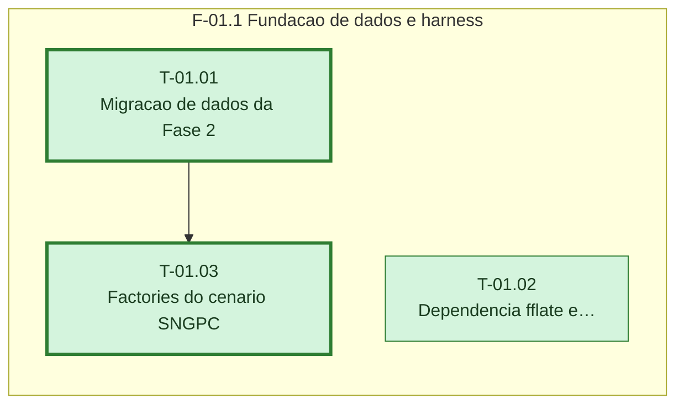

# Plano — Sprint 01 — Capacidade de testar SNGPC

## Objetivo da sprint

Entregar o schema da Fase 2, a dependencia de zip, os helpers de leitura de XML/zip e as factories do cenario SNGPC, sem regra de negocio.

## Critério de saída da sprint

npm test termina com 0 failed incluindo sngpc-modelo, sngpc-xml e sngpc-factories, e npm run typecheck sai com 0.

## Riscos conhecidos

- Migracao altera tabelas em producao (Supabase): aplicar com prisma migrate deploy antes do deploy do codigo (base/modelo-dados-atual.md)
- Reset do banco jg_test exige consentimento do usuario ao Prisma (base/modulos-e-testes.md)

## Fora de escopo

- Regras de venda e geracao de XML - sprints seguintes

## Fase F-01.1 — Fundacao de dados e harness

**Objetivo:** Entregar o schema da Fase 2, a dependencia de zip, os helpers de leitura de XML/zip e as factories do cenario SNGPC, sem regra de negocio.

**Tasks:** T-01.01, T-01.02, T-01.03

**Critério de saída:** Migracao aplicada, helpers de XML/zip e factories cobertos por testes verdes.

**Roda em paralelo com:** nenhuma.

**Caminho crítico:** T-01.01 → T-01.03

### Grafo de tasks



## Tasks

---

```yaml
id: T-01.01
titulo: "Migracao de dados da Fase 2"
objetivo: "Criar no schema os campos e tabelas da Fase 2 (D-07, D-10, D-13, D-14, D-16, D-05, D-06) com isolamento multiempresa."
arquivos:
  cria: [backend/prisma/migrations/20261017090000_farmacia_controlados/migration.sql, backend/tests/sngpc-modelo.test.ts]
  altera: [backend/prisma/schema.prisma, backend/src/db.ts]
teste_integracao: "Com a migracao aplicada pelo reset do jg_test, o Prisma grava uma Receita e um SaleItem com receitaId apontando para ela."
teste_funcional: "O cliente multiempresa no contexto da empresa A nao retorna Receita, SngpcArquivo nem SngpcInconsistencia criados para a empresa B."
criterio_aceite: "backend/tests/sngpc-modelo.test.ts passa e npm run typecheck sai com 0."
depende_de: []
paralelizavel: true
status: concluida
resultado: 2026-10-16 · suíte: sngpc-modelo 2 passed, 0 failed; typecheck 0 · real: 0.5 h
```

---

```yaml
id: T-01.02
titulo: "Dependencia fflate e helpers de XML e zip"
objetivo: "Adicionar fflate ao backend e helpers de teste para abrir zip base64 latin1 e consultar elementos do XML."
arquivos:
  cria: [backend/tests/sngpc-xml.ts, backend/tests/sngpc-xml.test.ts]
  altera: [backend/package.json, backend/package-lock.json]
teste_integracao: "Um XML latin1 com acentos zipado com fflate e codificado em base64 volta identico pelo helper abrirZipBase64."
teste_funcional: "Para um XML de exemplo, textoEm(xml, \"cabecalho/cnpjEmissor\") devolve 12345678000199 e contar(xml, \"medicamentoVenda\") devolve 2."
criterio_aceite: "backend/tests/sngpc-xml.test.ts passa e fflate consta em dependencies do backend/package.json."
depende_de: []
paralelizavel: true
status: concluida
resultado: 2026-10-16 · suíte: sngpc-xml 2 passed, 0 failed; typecheck 0 · real: 0.4 h
```

---

```yaml
id: T-01.03
titulo: "Factories do cenario SNGPC"
objetivo: "Criar cenarioSngpc() com empresa e filial com CNPJ, farmaceutico RT com CPF, caixa aberto e produto SNGPC com lote e livro-razao."
arquivos:
  cria: [backend/tests/sngpc-factories.ts, backend/tests/sngpc-factories.test.ts]
  altera: []
teste_integracao: "O cenario padrao (produto controlado lista B1 com dois lotes) responde coerente true em GET /api/farmacia/lotes/conciliacao."
teste_funcional: "cenarioSngpc({ classe: \"ANTIMICROBIANO\" }) cria produto com classeSngpc ANTIMICROBIANO e listaPortaria344 nula."
criterio_aceite: "backend/tests/sngpc-factories.test.ts passa."
depende_de: [T-01.01]
paralelizavel: false
status: concluida
resultado: 2026-10-16 · suíte: sngpc-factories 2 passed, 0 failed · real: 0.5 h
```
