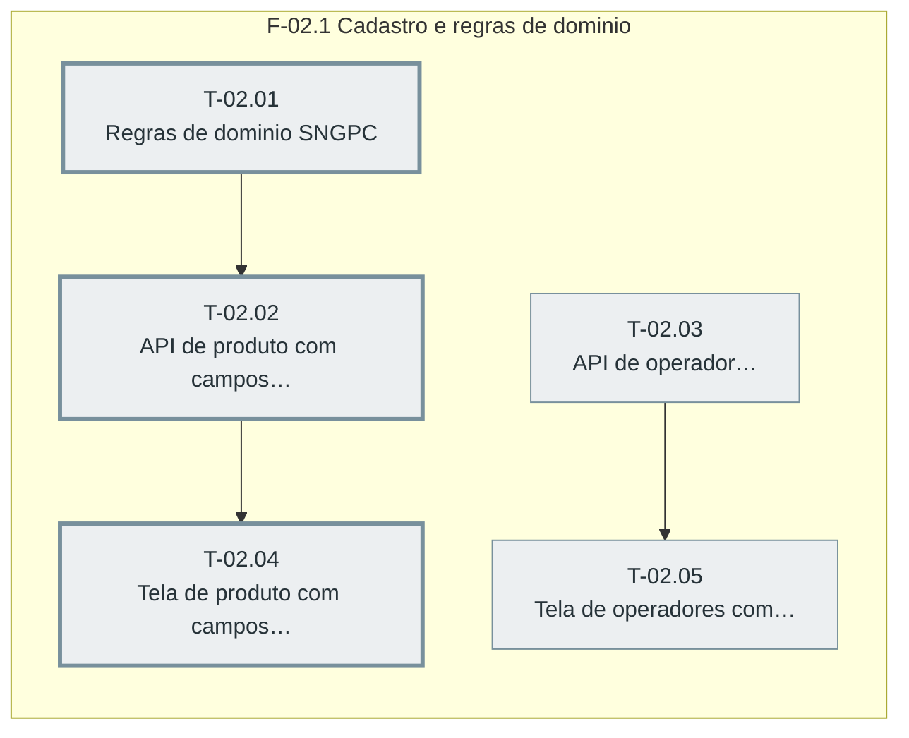

# Plano — Sprint 02 — Cadastro SNGPC

## Objetivo da sprint

Produto e operador passam a carregar os dados SNGPC (classe, lista, unidade, maximo por receita; farmaceutico RT com CPF e CRF) com regras de dominio puras.

## Critério de saída da sprint

npm test termina com 0 failed e as telas de produto e de operadores verificadas por navegador sem pageerror.

## Riscos conhecidos

- Listas da Portaria 344 mudam por RDC; cadastro manual (D-26, base/regulacao-controlados.md)

## Fora de escopo

- Importacao da lista oficial da Portaria 344 (D-26)

## Fase F-02.1 — Cadastro e regras de dominio

**Objetivo:** Produto e operador passam a carregar os dados SNGPC (classe, lista, unidade, maximo por receita; farmaceutico RT com CPF e CRF) com regras de dominio puras.

**Tasks:** T-02.01, T-02.02, T-02.03, T-02.04, T-02.05

**Critério de saída:** Regras SNGPC testadas e campos SNGPC gravados e exibidos em produto e operador.

**Roda em paralelo com:** nenhuma.

**Caminho crítico:** T-02.01 → T-02.02 → T-02.04

### Grafo de tasks



## Tasks

---

```yaml
id: T-02.01
titulo: "Regras de dominio SNGPC"
objetivo: "Funcoes puras de tipo de receituario por produto (D-08), validade da receita (D-04) e conselhos permitidos (D-25)."
arquivos:
  cria: [backend/src/utils/sngpc/regras.ts, backend/tests/sngpc-regras.test.ts, backend/tests/fixtures/sngpc-tipos-receituario.json]
  altera: []
teste_integracao: "Para cada lista A1 a C5 e para antimicrobiano, o tipo derivado bate com a tabela st_TipoReceituario do Guia p.19 gravada na fixture."
teste_funcional: "Receita tipo 2 emitida ha 31 dias e vencida e ha 30 dias nao; receita tipo 5 com 11 dias e vencida."
criterio_aceite: "backend/tests/sngpc-regras.test.ts passa."
depende_de: []
paralelizavel: true
status: pendente
```

---

```yaml
id: T-02.02
titulo: "API de produto com campos SNGPC"
objetivo: "POST/PUT /api/produtos validam e gravam classeSngpc, listaPortaria344, unidadeSngpc e qtdMaxReceita, e GET /api/produtos/:codigo os devolve."
arquivos:
  cria: [backend/tests/sngpc-produto-api.test.ts]
  altera: [backend/src/routes/produtos.ts]
teste_integracao: "POST /api/produtos com classeSngpc CONTROLADO sem registroMS responde 400 e com registroMS grava classe, lista B1 e unidade 2."
teste_funcional: "PUT com classeSngpc ANTIMICROBIANO e listaPortaria344 B1 responde 400 e GET /api/produtos/:codigo de um B1 devolve tipoReceituario 2."
criterio_aceite: "backend/tests/sngpc-produto-api.test.ts passa."
depende_de: [T-02.01]
paralelizavel: false
status: pendente
```

---

```yaml
id: T-02.03
titulo: "API de operador farmaceutico RT"
objetivo: "Operadores ganham farmaceuticoRT, CPF validado, CRF e UF; middleware requerFarmaceuticoRT restringe rotas ao RT (D-06)."
arquivos:
  cria: [backend/tests/sngpc-farmaceutico.test.ts]
  altera: [backend/src/routes/auth.ts, backend/src/middlewares/auth.ts]
teste_integracao: "PUT /api/auth/operadores/:id com farmaceuticoRT true e CPF de digito invalido responde 400, e com CPF valido grava e GET /api/auth/operadores devolve cpf, crf e crfUf."
teste_funcional: "Uma rota protegida por requerFarmaceuticoRT responde 403 para ADMIN sem a marca e 200 para usuario marcado RT."
criterio_aceite: "backend/tests/sngpc-farmaceutico.test.ts passa."
depende_de: []
paralelizavel: true
status: pendente
```

---

```yaml
id: T-02.04
titulo: "Tela de produto com campos SNGPC"
objetivo: "Aba Farmacia do produto mostra e edita classe, lista Portaria 344, unidade SNGPC e maximo por receita."
arquivos:
  cria: []
  altera: [frontend/produto.html]
teste_integracao: "No navegador com /api interceptado, a aba Farmacia carrega os quatro campos do GET e o PUT de salvar leva os quatro valores."
teste_funcional: "No navegador, escolher a classe Antimicrobiano esconde e limpa o campo Lista Portaria 344."
criterio_aceite: "Verificacao por navegador (D-19 da Fase 1) registra os dois cenarios com zero pageerror."
depende_de: [T-02.02]
paralelizavel: false
status: pendente
```

---

```yaml
id: T-02.05
titulo: "Tela de operadores com dados do RT"
objetivo: "Cadastro de operadores em configuracoes ganha marca de farmaceutico RT com CPF, CRF e UF."
arquivos:
  cria: []
  altera: [frontend/configuracoes.html]
teste_integracao: "No navegador com /api interceptado, salvar operador com RT marcado envia farmaceuticoRT, cpf, crf e crfUf no PUT."
teste_funcional: "No navegador, desmarcar RT esconde os campos CPF, CRF e UF."
criterio_aceite: "Verificacao por navegador registra os dois cenarios com zero pageerror."
depende_de: [T-02.03]
paralelizavel: false
status: pendente
```
