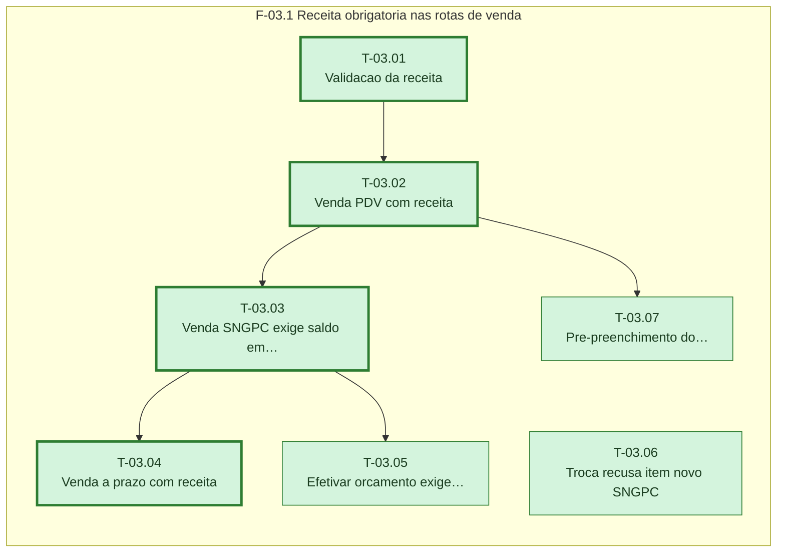

# Plano — Sprint 03 — Receita na venda (backend)

## Objetivo da sprint

Toda venda de produto SNGPC exige receita valida e saldo em lote, gravando Receita ligada aos itens, no PDV, na venda a prazo e na efetivacao de orcamento.

## Critério de saída da sprint

npm test termina com 0 failed incluindo os testes sngpc-receita, sngpc-venda-pdv, sngpc-venda-prazo, sngpc-orcamento, sngpc-troca e sngpc-comprador.

## Riscos conhecidos

- Captura da receita no fluxo do PDV pode atrasar vendas comuns; regras so se aplicam a produto com classeSngpc (base/fluxos-venda-estoque.md)

## Fora de escopo

- Telas (sprint-04)
- SNCR e receita eletronica (D-27)

## Fase F-03.1 — Receita obrigatoria nas rotas de venda

**Objetivo:** Toda venda de produto SNGPC exige receita valida e saldo em lote, gravando Receita ligada aos itens, no PDV, na venda a prazo e na efetivacao de orcamento.

**Tasks:** T-03.01, T-03.02, T-03.03, T-03.04, T-03.05, T-03.06, T-03.07

**Critério de saída:** Rotas de venda recusam item SNGPC sem receita valida ou sem lote e gravam a receita quando valida.

**Roda em paralelo com:** nenhuma.

**Caminho crítico:** T-03.01 → T-03.02 → T-03.03 → T-03.04

### Grafo de tasks



## Tasks

---

```yaml
id: T-03.01
titulo: "Validacao da receita"
objetivo: "validarReceita devolve erros e alertas segundo o Guia 4.2 e as decisoes D-04, D-10, D-24 e D-25."
arquivos:
  cria: [backend/src/utils/sngpc/receita.ts, backend/tests/sngpc-receita.test.ts]
  altera: []
teste_integracao: "Receita tipo 2 de produto B1 sem comprador devolve o erro de comprador obrigatorio e com conselho CRMV em uso humano devolve erro de conselho."
teste_funcional: "Receita tipo 5 sem numero, com paciente completo e quantidade 3 acima de qtdMaxReceita 2 devolve zero erros e o alerta QTD_ACIMA_MAXIMO, e quantidade 1000 devolve erro de maximo 999."
criterio_aceite: "backend/tests/sngpc-receita.test.ts passa."
depende_de: [T-02.01]
paralelizavel: false
status: concluida
resultado: 2026-10-16 · suíte: sngpc-receita 3 passed, 0 failed; typecheck 0 · real: 0.6 h
```

---

```yaml
id: T-03.02
titulo: "Venda PDV com receita"
objetivo: "POST /api/vendas exige receita para item SNGPC, recusa vencida ou alerta nao confirmado, e grava Receita e SaleItem.receitaId."
arquivos:
  cria: [backend/src/utils/sngpc/vendaReceita.ts, backend/tests/sngpc-venda-pdv.test.ts]
  altera: [backend/src/routes/vendas.ts]
teste_integracao: "POST /api/vendas de produto B1 com receita valida responde 201 e grava Receita tipo 2, SaleItem.receitaId e LoteMovimento VENDA do item."
teste_funcional: "O mesmo POST sem receita responde 400 com Receita obrigatoria e com receita de 31 dias responde 400 com Receita vencida."
criterio_aceite: "backend/tests/sngpc-venda-pdv.test.ts passa e farmacia-fefo-venda-pdv.test.ts continua verde."
depende_de: [T-03.01, T-01.03]
paralelizavel: false
status: concluida
resultado: 2026-10-16 · suíte: sngpc-venda-pdv 4 + farmacia-fefo-venda-pdv + farmacia-lote-livro: 16 passed, 0 failed · real: 1.0 h
```

---

```yaml
id: T-03.03
titulo: "Venda SNGPC exige saldo em lote"
objetivo: "Produto SNGPC so vende quando os lotes nao vencidos cobrem a quantidade (D-09)."
arquivos:
  cria: [backend/tests/sngpc-lote-obrigatorio.test.ts]
  altera: [backend/src/utils/fefo.ts, backend/src/routes/vendas.ts]
teste_integracao: "Produto controlado com estoque 5 e lotes somando 2 recusa a venda de 3 com 400 citando saldo em lote."
teste_funcional: "Produto sem classeSngpc nas mesmas condicoes vende 3 com 201."
criterio_aceite: "backend/tests/sngpc-lote-obrigatorio.test.ts passa e farmacia-lote-livro.test.ts continua verde."
depende_de: [T-03.02]
paralelizavel: false
status: concluida
resultado: 2026-10-16 · suíte: sngpc-lote-obrigatorio 2 + regressao 14: 16 passed, 0 failed · real: 0.4 h
```

---

```yaml
id: T-03.04
titulo: "Venda a prazo com receita"
objetivo: "POST /api/vendas-fora-pdv aplica as mesmas regras de receita e lote para item SNGPC."
arquivos:
  cria: [backend/tests/sngpc-venda-prazo.test.ts]
  altera: [backend/src/routes/vendasForaPdv.ts]
teste_integracao: "POST /api/vendas-fora-pdv com item B1 e receita valida responde 201 e grava Receita ligada ao item."
teste_funcional: "O mesmo POST sem receita responde 400 com Receita obrigatoria."
criterio_aceite: "backend/tests/sngpc-venda-prazo.test.ts passa."
depende_de: [T-03.03]
paralelizavel: false
status: concluida
resultado: 2026-10-16 · suíte: sngpc-venda-prazo 2 + farmacia-venda-fora-pdv-fefo 1: 3 passed, 0 failed · real: 0.4 h
```

---

```yaml
id: T-03.05
titulo: "Efetivar orcamento exige receita"
objetivo: "Orcamento com item SNGPC so efetiva com receitas no corpo do POST /api/vendas/:id/efetivar (D-11)."
arquivos:
  cria: [backend/tests/sngpc-orcamento.test.ts]
  altera: [backend/src/routes/vendas.ts]
teste_integracao: "Orcamento de B1 criado sem receita responde 201 e a efetivacao com receita valida responde 200 e grava Receita."
teste_funcional: "A efetivacao do mesmo orcamento sem receita responde 400 com Receita obrigatoria."
criterio_aceite: "backend/tests/sngpc-orcamento.test.ts passa."
depende_de: [T-03.03]
paralelizavel: false
status: concluida
resultado: 2026-10-16 · suíte: sngpc-orcamento 2 + sngpc-venda-pdv 4: 6 passed, 0 failed · real: 0.4 h
```

---

```yaml
id: T-03.06
titulo: "Troca recusa item novo SNGPC"
objetivo: "POST /api/trocas recusa item novo com classeSngpc (D-11)."
arquivos:
  cria: [backend/tests/sngpc-troca.test.ts]
  altera: [backend/src/routes/trocas.ts]
teste_integracao: "Troca com item novo B1 responde 400 citando venda com receita no PDV."
teste_funcional: "Troca com item novo sem classeSngpc responde 201."
criterio_aceite: "backend/tests/sngpc-troca.test.ts passa e farmacia-lote-livro.test.ts continua verde."
depende_de: []
paralelizavel: true
status: concluida
resultado: 2026-10-16 · suíte: sngpc-troca 2 + farmacia-lote-livro 10: 12 passed, 0 failed · real: 0.3 h
```

---

```yaml
id: T-03.07
titulo: "Pre-preenchimento do comprador"
objetivo: "GET /api/farmacia/receitas/comprador/:documento devolve so os dados do comprador (nunca paciente nem prescritor) da ultima receita com o mesmo documento, a qualquer operador autenticado (D-23, D-30)."
arquivos:
  cria: [backend/tests/sngpc-comprador.test.ts]
  altera: [backend/src/routes/farmacia.ts]
teste_integracao: "Apos uma venda com receita do comprador de documento 99878A, o GET devolve nome, tipoDocumento, orgaoExpedidor e UF dessa receita."
teste_funcional: "Documento sem receita anterior devolve 404."
criterio_aceite: "backend/tests/sngpc-comprador.test.ts passa."
depende_de: [T-03.02]
paralelizavel: false
status: concluida
resultado: 2026-10-16 · suíte: sngpc-comprador 2 passed, 0 failed · real: 0.3 h
```
