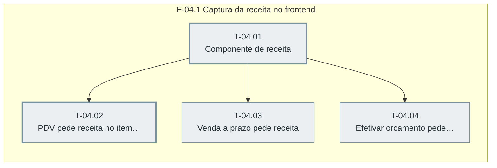

# Plano — Sprint 04 — Receita nas telas de venda

## Objetivo da sprint

PDV, venda a prazo e orcamentos pedem a receita ao vender produto SNGPC, com pre-preenchimento do comprador.

## Critério de saída da sprint

As quatro tasks verificadas por navegador sem pageerror e npm test termina com 0 failed.

## Riscos conhecidos

- pdv.html tem 1633 linhas e dois pontos de envio da venda (linhas 1333 e 1410, base/fluxos-venda-estoque.md)

## Fora de escopo

- Mudancas no layout geral do PDV

## Fase F-04.1 — Captura da receita no frontend

**Objetivo:** PDV, venda a prazo e orcamentos pedem a receita ao vender produto SNGPC, com pre-preenchimento do comprador.

**Tasks:** T-04.01, T-04.02, T-04.03, T-04.04

**Critério de saída:** Os tres fluxos de venda enviam receitas ao backend e cancelar o modal nao adiciona o item.

**Roda em paralelo com:** nenhuma.

**Caminho crítico:** T-04.01 → T-04.02

### Grafo de tasks



## Tasks

---

```yaml
id: T-04.01
titulo: "Componente de receita"
objetivo: "frontend/ui/receita.js expoe JGReceita.abrir(produto, quantidade) com campos por tipo de receituario, validacao de validade e pre-preenchimento do comprador pelo documento (D-23)."
arquivos:
  cria: [frontend/ui/receita.js]
  altera: [frontend/pdv.html]
teste_integracao: "No navegador em pdv.html, JGReceita.abrir com produto B1 mostra os campos de comprador, oculta os de paciente e, ao sair do documento, preenche nome e orgao com a resposta de GET /api/farmacia/receitas/comprador/:documento."
teste_funcional: "Preencher e confirmar resolve um objeto com tipoReceituario 2 e comprador, e data de 31 dias mostra Receita vencida sem fechar."
criterio_aceite: "Verificacao por navegador registra os dois cenarios com zero pageerror."
depende_de: [T-03.07]
paralelizavel: false
status: pendente
```

---

```yaml
id: T-04.02
titulo: "PDV pede receita no item SNGPC"
objetivo: "Adicionar item SNGPC no PDV abre o componente e a finalizacao envia receitas e itens[].receita."
arquivos:
  cria: []
  altera: [frontend/pdv.html]
teste_integracao: "No navegador, adicionar produto B1 abre o modal e finalizar envia POST /api/vendas com receitas[0] e itens[0].receita igual a 0."
teste_funcional: "No navegador, cancelar o modal nao adiciona o item ao carrinho."
criterio_aceite: "Verificacao por navegador registra os dois cenarios com zero pageerror."
depende_de: [T-04.01]
paralelizavel: false
status: pendente
```

---

```yaml
id: T-04.03
titulo: "Venda a prazo pede receita"
objetivo: "vendas-fora-pdv.html usa o componente e envia receitas no POST."
arquivos:
  cria: []
  altera: [frontend/vendas-fora-pdv.html]
teste_integracao: "No navegador, item B1 na venda a prazo abre o modal e o POST /api/vendas-fora-pdv leva receitas[0]."
teste_funcional: "No navegador, cancelar o modal nao adiciona o item."
criterio_aceite: "Verificacao por navegador registra os dois cenarios com zero pageerror."
depende_de: [T-04.01]
paralelizavel: false
status: pendente
```

---

```yaml
id: T-04.04
titulo: "Efetivar orcamento pede receita"
objetivo: "orcamentos.html pede a receita dos itens SNGPC antes de efetivar."
arquivos:
  cria: []
  altera: [frontend/orcamentos.html]
teste_integracao: "No navegador, efetivar orcamento com item B1 abre o modal e o POST /efetivar leva receitas[0]."
teste_funcional: "No navegador, cancelar o modal nao envia a efetivacao."
criterio_aceite: "Verificacao por navegador registra os dois cenarios com zero pageerror."
depende_de: [T-04.01]
paralelizavel: false
status: pendente
```
