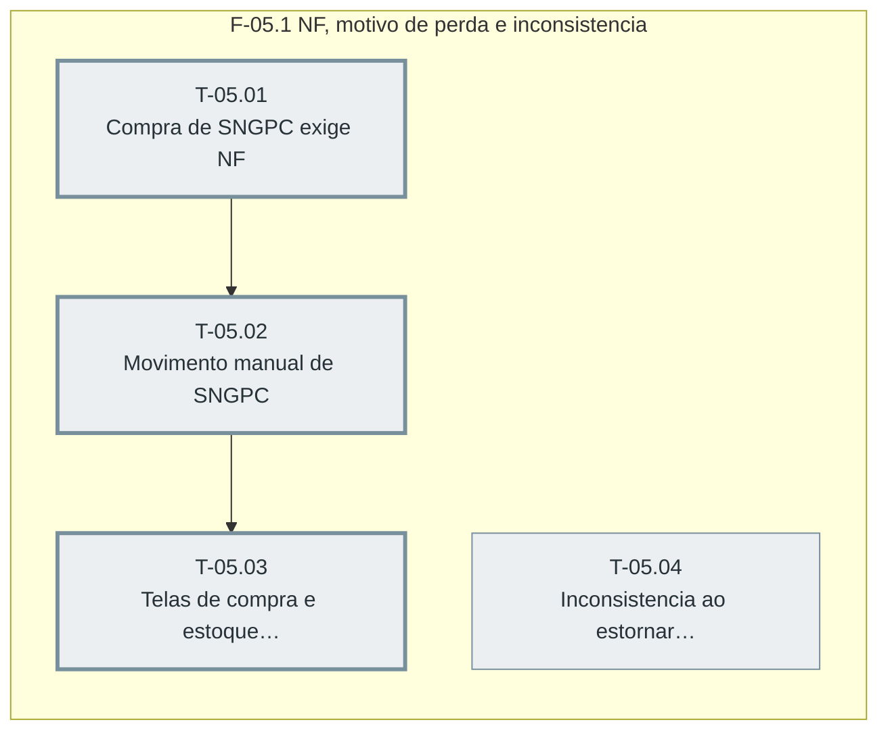

# Plano — Sprint 05 — Entradas, perdas e inconsistencias

## Objetivo da sprint

Compra e movimentos manuais de produto SNGPC passam a registrar NF e motivo de perda no livro-razao, e o estorno de venda ja exportada abre inconsistencia.

## Critério de saída da sprint

npm test termina com 0 failed incluindo sngpc-compra, sngpc-estoque-manual e sngpc-inconsistencia, e telas verificadas por navegador.

## Riscos conhecidos

- Fornecedor sem CNPJ cadastrado impede receber compra de controlado (D-13)

## Fora de escopo

- Transferencia entre estabelecimentos (D-27)

## Fase F-05.1 — NF, motivo de perda e inconsistencia

**Objetivo:** Compra e movimentos manuais de produto SNGPC passam a registrar NF e motivo de perda no livro-razao, e o estorno de venda ja exportada abre inconsistencia.

**Tasks:** T-05.01, T-05.02, T-05.03, T-05.04

**Critério de saída:** Livro-razao de produto SNGPC guarda NF nas entradas e motivo nas perdas, e estorno pos-exportacao gera inconsistencia.

**Roda em paralelo com:** nenhuma.

**Caminho crítico:** T-05.01 → T-05.02 → T-05.03

### Grafo de tasks



## Tasks

---

```yaml
id: T-05.01
titulo: "Compra de SNGPC exige NF"
objetivo: "Receber compra com item SNGPC exige nfNumero, nfData e CNPJ do fornecedor, gravados em Purchase e no LoteMovimento ENTRADA_COMPRA (D-13)."
arquivos:
  cria: [backend/tests/sngpc-compra.test.ts]
  altera: [backend/src/routes/compras.ts, backend/src/utils/fefo.ts]
teste_integracao: "Receber compra com item B1 sem NF responde 400 e com NF grava Purchase.nfNumero e LoteMovimento ENTRADA_COMPRA com nfNumero e cnpjOrigem do fornecedor."
teste_funcional: "Compra so de produto sem classeSngpc recebe sem NF com 200."
criterio_aceite: "backend/tests/sngpc-compra.test.ts passa e farmacia-compra-lote.test.ts continua verde."
depende_de: []
paralelizavel: false
status: pendente
```

---

```yaml
id: T-05.02
titulo: "Movimento manual de SNGPC"
objetivo: "Saida e ajuste para baixo de produto SNGPC exigem motivoPerda 1 a 9; entrada exige NF e lote; ajuste para cima e recusado (D-14)."
arquivos:
  cria: [backend/tests/sngpc-estoque-manual.test.ts]
  altera: [backend/src/routes/estoque.ts]
teste_integracao: "Saida de produto B1 sem motivoPerda responde 400 e com motivoPerda 3 grava LoteMovimento com motivoPerda 3."
teste_funcional: "Ajuste de B1 de 5 para 8 responde 400 e o mesmo ajuste em produto sem classeSngpc responde 200."
criterio_aceite: "backend/tests/sngpc-estoque-manual.test.ts passa e farmacia-lote-livro.test.ts continua verde."
depende_de: [T-05.01]
paralelizavel: false
status: pendente
```

---

```yaml
id: T-05.03
titulo: "Telas de compra e estoque para SNGPC"
objetivo: "compras.html pede NF ao receber item SNGPC e estoque.html pede motivo SNGPC na saida e no ajuste."
arquivos:
  cria: []
  altera: [frontend/compras.html, frontend/estoque.html]
teste_integracao: "No navegador, receber compra com item controlado mostra numero e data da NF e envia os dois no corpo."
teste_funcional: "No navegador, a saida de produto controlado mostra os 9 motivos SNGPC e nao envia sem motivo."
criterio_aceite: "Verificacao por navegador registra os dois cenarios com zero pageerror."
depende_de: [T-05.02]
paralelizavel: false
status: pendente
```

---

```yaml
id: T-05.04
titulo: "Inconsistencia ao estornar venda exportada"
objetivo: "Cancelamento ou devolucao de venda SNGPC dentro de periodo ja exportado cria SngpcInconsistencia ABERTA (D-05)."
arquivos:
  cria: [backend/src/utils/sngpc/inconsistencias.ts, backend/tests/sngpc-inconsistencia.test.ts]
  altera: [backend/src/routes/vendas.ts, backend/src/routes/trocas.ts]
teste_integracao: "Cancelar venda B1 cuja data esta dentro de um SngpcArquivo MOVIMENTACAO cria SngpcInconsistencia ABERTA ligada a venda."
teste_funcional: "Devolucao via POST /api/trocas de venda B1 exportada cria inconsistencia, e cancelar venda de periodo nao exportado nao cria."
criterio_aceite: "backend/tests/sngpc-inconsistencia.test.ts passa."
depende_de: []
paralelizavel: true
status: pendente
```
