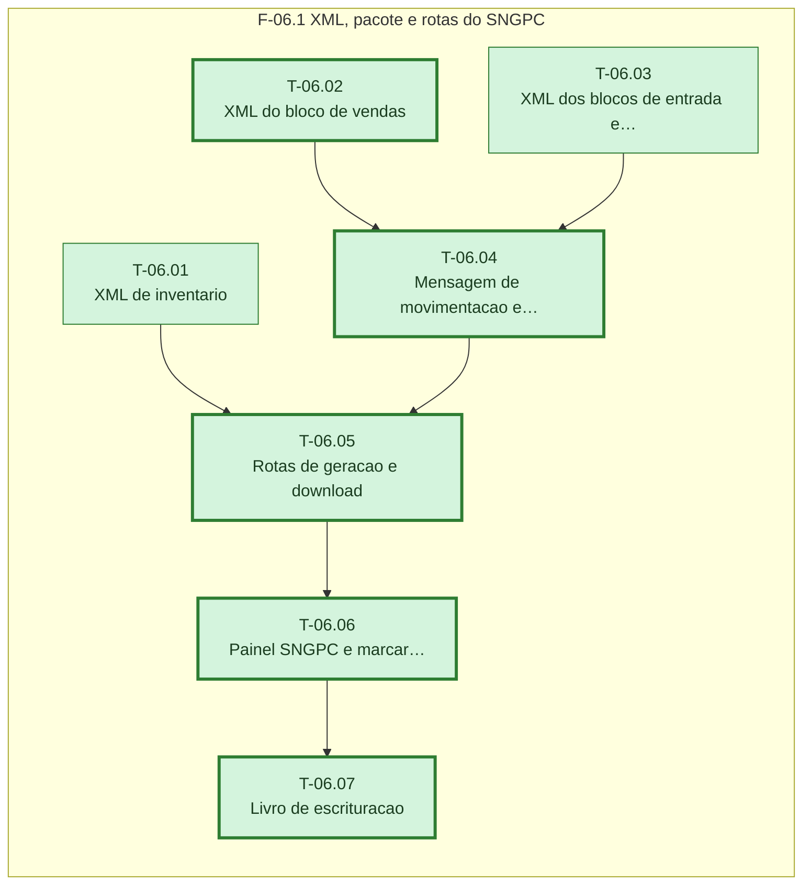

# Plano — Sprint 06 — Geracao dos arquivos SNGPC

## Objetivo da sprint

Gerar, guardar e baixar os XML de inventario e de movimentacao no padrao do Guia v2.3, com painel de prazo e livro de escrituracao, restritos ao RT.

## Critério de saída da sprint

npm test termina com 0 failed incluindo os testes sngpc-inventario, sngpc-xml-vendas, sngpc-xml-entradas-perdas, sngpc-movimentacao, sngpc-rotas, sngpc-painel e sngpc-livro.

## Riscos conhecidos

- XSD oficial indisponivel; conformidade so contra o Guia (D-22, base/00-LACUNAS.md)
- Cancelamento e devolucao nao tem operacao no padrao XML (base/00-LACUNAS.md, D-05)

## Fora de escopo

- Envio automatico ao SNGPC (D-02)
- Manipulacao e insumos (D-27)

## Fase F-06.1 — XML, pacote e rotas do SNGPC

**Objetivo:** Gerar, guardar e baixar os XML de inventario e de movimentacao no padrao do Guia v2.3, com painel de prazo e livro de escrituracao, restritos ao RT.

**Tasks:** T-06.01, T-06.02, T-06.03, T-06.04, T-06.05, T-06.06, T-06.07

**Critério de saída:** Rotas do RT geram arquivos que conferem com o Guia v2.3 e o painel informa prazo e pendencias.

**Roda em paralelo com:** nenhuma.

**Caminho crítico:** T-06.02 → T-06.04 → T-06.05 → T-06.06 → T-06.07

### Grafo de tasks



## Tasks

---

```yaml
id: T-06.01
titulo: "XML de inventario"
objetivo: "montarInventario monta mensagemSNGPCInventario do saldo dos lotes SNGPC na data ou devolve pendencias (D-15)."
arquivos:
  cria: [backend/src/utils/sngpc/inventario.ts, backend/tests/sngpc-inventario.test.ts]
  altera: []
teste_integracao: "Cenario com dois lotes de B1 gera XML com dois medicamentoEntrada com registroMS, lote, quantidade e classe 2, e cabecalho com CNPJ da filial e CPF do RT."
teste_funcional: "Produto SNGPC com saldo sem lote faz a funcao devolver a pendencia SALDO_SEM_LOTE e nenhum XML."
criterio_aceite: "backend/tests/sngpc-inventario.test.ts passa."
depende_de: []
paralelizavel: true
status: concluida
resultado: 2026-10-16 · suíte: sngpc-inventario 2 passed, 0 failed · real: 0.6 h
```

---

```yaml
id: T-06.02
titulo: "XML do bloco de vendas"
objetivo: "blocoVendas monta saidaMedicamentoVendaAoConsumidor por receita a partir das linhas VENDA liquidas do periodo (D-12)."
arquivos:
  cria: [backend/src/utils/sngpc/xmlVendas.ts, backend/tests/sngpc-xml-vendas.test.ts]
  altera: []
teste_integracao: "Venda com dois itens B1 numa receita gera um saidaMedicamentoVendaAoConsumidor com dois medicamentoVenda e comprador preenchido."
teste_funcional: "Venda cancelada no periodo nao gera bloco, venda de antimicrobiano gera pacienteMedicamento e usoProlongado N, e linha VENDA sem receita devolve a pendencia VENDA_SEM_RECEITA."
criterio_aceite: "backend/tests/sngpc-xml-vendas.test.ts passa."
depende_de: []
paralelizavel: true
status: concluida
resultado: 2026-10-16 · suíte: sngpc-xml-vendas 2 passed, 0 failed · real: 0.9 h
```

---

```yaml
id: T-06.03
titulo: "XML dos blocos de entrada e perda"
objetivo: "blocosEntradaPerda monta entradaMedicamentos por NF e saidaMedicamentoPerda por motivo a partir do livro-razao (D-12, D-14)."
arquivos:
  cria: [backend/src/utils/sngpc/xmlEntradasPerdas.ts, backend/tests/sngpc-xml-entradas-perdas.test.ts]
  altera: []
teste_integracao: "ENTRADA_COMPRA com NF 123 gera entradaMedicamentos com numeroNotaFiscal 123, cnpjOrigem do fornecedor e tipoOperacaoNotaFiscal 1."
teste_funcional: "SAIDA_MANUAL com motivoPerda 3 de 2 unidades gera saidaMedicamentoPerda com motivoPerdaMedicamento 3 e quantidade 2."
criterio_aceite: "backend/tests/sngpc-xml-entradas-perdas.test.ts passa."
depende_de: []
paralelizavel: true
status: concluida
resultado: 2026-10-16 · suíte: sngpc-xml-entradas-perdas 2 passed, 0 failed; typecheck 0 · real: 0.7 h
```

---

```yaml
id: T-06.04
titulo: "Mensagem de movimentacao e pacote zip"
objetivo: "montarMovimentacao junta cabecalho e blocos na ordem do Guia e empacotar gera zip base64 latin1 com MD5 (D-02, D-17)."
arquivos:
  cria: [backend/src/utils/sngpc/movimentacao.ts, backend/src/utils/sngpc/pacote.ts, backend/tests/sngpc-movimentacao.test.ts]
  altera: []
teste_integracao: "Periodo com compra, venda e perda gera mensagemSNGPC com dataInicio e dataFim e os blocos na ordem entrada, venda, perda."
teste_funcional: "empacotar devolve zip base64 que abre no XML original e hash igual ao MD5 hex de 32 caracteres do base64."
criterio_aceite: "backend/tests/sngpc-movimentacao.test.ts passa."
depende_de: [T-06.02, T-06.03]
paralelizavel: false
status: concluida
resultado: 2026-10-16 · suíte: sngpc-movimentacao 2 passed, 0 failed · real: 0.5 h
```

---

```yaml
id: T-06.05
titulo: "Rotas de geracao e download"
objetivo: "Rotas /api/farmacia/sngpc de inventario, movimentacao com periodo continuo, lista e download, restritas ao RT (D-06, D-16, D-20)."
arquivos:
  cria: [backend/src/routes/sngpc.ts, backend/tests/sngpc-rotas.test.ts]
  altera: [backend/src/app.ts]
teste_integracao: "POST /api/farmacia/sngpc/movimentacao como RT grava SngpcArquivo GERADO com hash e o segundo POST comeca no dia seguinte ao dataFim do primeiro."
teste_funcional: "O mesmo POST como ADMIN sem marca de RT responde 403, com pendencia de dados responde 422 com a lista, e POST /inventario com data de 8 dias atras responde 400."
criterio_aceite: "backend/tests/sngpc-rotas.test.ts passa e cada arquivo gerado deixa um registro SNGPC_ARQUIVO_GERADO em AuditLog."
depende_de: [T-06.01, T-06.04]
paralelizavel: false
status: concluida
resultado: 2026-10-16 · suíte: sngpc-rotas 2 passed, 0 failed; typecheck 0 · real: 1.0 h
```

---

```yaml
id: T-06.06
titulo: "Painel SNGPC e marcar enviado"
objetivo: "GET painel com ultimo arquivo, dias desde ele, alerta de 7 dias, pendencias e inconsistencias; marcar arquivo enviado e inconsistencia notificada (D-16, D-19)."
arquivos:
  cria: [backend/tests/sngpc-painel.test.ts]
  altera: [backend/src/routes/sngpc.ts]
teste_integracao: "GET /api/farmacia/sngpc/painel com ultimo arquivo de 8 dias atras devolve alertaPrazo true e a contagem de inconsistencias abertas."
teste_funcional: "POST /api/farmacia/sngpc/arquivos/:id/enviado muda status para ENVIADO e grava enviadoPorId."
criterio_aceite: "backend/tests/sngpc-painel.test.ts passa."
depende_de: [T-06.05]
paralelizavel: false
status: concluida
resultado: 2026-10-16 · suíte: sngpc-painel 2 + sngpc-rotas 2: 4 passed, 0 failed · real: 0.7 h
```

---

```yaml
id: T-06.07
titulo: "Livro de escrituracao"
objetivo: "GET /api/farmacia/sngpc/livro lista as movimentacoes SNGPC do periodo por produto e lote com saldo final (RDC 22 art. 19 II)."
arquivos:
  cria: [backend/tests/sngpc-livro.test.ts]
  altera: [backend/src/routes/sngpc.ts]
teste_integracao: "Periodo com entrada de 10 e venda de 3 de um lote devolve as duas linhas e saldo final 7 para o lote."
teste_funcional: "GET do livro por usuario sem marca de RT responde 403."
criterio_aceite: "backend/tests/sngpc-livro.test.ts passa."
depende_de: [T-06.06]
paralelizavel: false
status: concluida
resultado: 2026-10-16 · suíte: sngpc-livro 2 passed, 0 failed · real: 0.5 h
```
