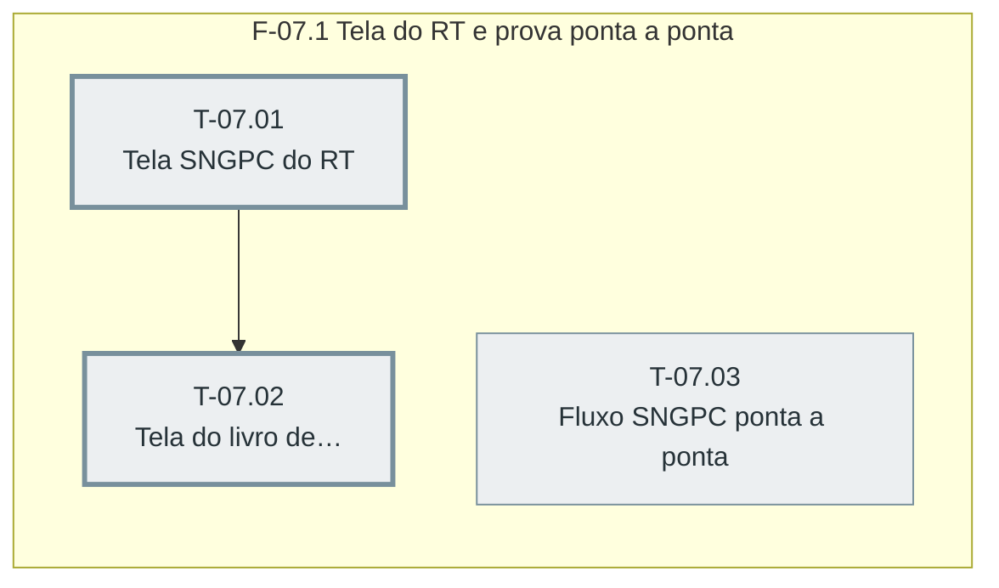

# Plano — Sprint 07 — Tela SNGPC e fluxo ponta a ponta

## Objetivo da sprint

O RT opera o SNGPC por uma tela propria e um teste ponta a ponta prova que o fluxo inteiro gera arquivos coerentes com o estoque.

## Critério de saída da sprint

npm test termina com 0 failed incluindo sngpc-ponta-a-ponta e a tela sngpc.html verificada por navegador sem pageerror.

## Riscos conhecidos

- Aceite real no portal SNGPC depende do RT e do CNPJ reais da farmacia (D-03); sem eles a entrega fica pronta em simulacao

## Fora de escopo

- Envio automatico (D-02)

## Fase F-07.1 — Tela do RT e prova ponta a ponta

**Objetivo:** O RT opera o SNGPC por uma tela propria e um teste ponta a ponta prova que o fluxo inteiro gera arquivos coerentes com o estoque.

**Tasks:** T-07.01, T-07.02, T-07.03

**Critério de saída:** Tela sngpc.html opera geracao, download, envio e livro, e o teste ponta a ponta passa.

**Roda em paralelo com:** nenhuma.

**Caminho crítico:** T-07.01 → T-07.02

### Grafo de tasks



## Tasks

---

```yaml
id: T-07.01
titulo: "Tela SNGPC do RT"
objetivo: "frontend/sngpc.html com painel, geracao, historico, download, marcar enviado e inconsistencias, com item no menu do modulo farmacia."
arquivos:
  cria: [frontend/sngpc.html]
  altera: [frontend/ui/shell.js, backend/modulos.json]
teste_integracao: "No navegador com /api interceptado, o painel mostra ultimo arquivo, alerta de prazo e pendencias, e Gerar movimentacao faz o POST e lista o arquivo."
teste_funcional: "No navegador, Baixar chama GET /download e Marcar enviado chama POST /enviado."
criterio_aceite: "Verificacao por navegador registra os dois cenarios com zero pageerror."
depende_de: []
paralelizavel: false
status: pendente
```

---

```yaml
id: T-07.02
titulo: "Tela do livro de escrituracao"
objetivo: "sngpc.html ganha a secao do livro de escrituracao com filtro de periodo."
arquivos:
  cria: []
  altera: [frontend/sngpc.html]
teste_integracao: "No navegador, filtrar o periodo chama GET /api/farmacia/sngpc/livro com inicio e fim e lista as linhas devolvidas."
teste_funcional: "No navegador, periodo sem movimentos mostra o estado vazio."
criterio_aceite: "Verificacao por navegador registra os dois cenarios com zero pageerror."
depende_de: [T-07.01]
paralelizavel: false
status: pendente
```

---

```yaml
id: T-07.03
titulo: "Fluxo SNGPC ponta a ponta"
objetivo: "Teste de compra com NF, venda com receita, perda, inventario e movimentacao pelas rotas reais."
arquivos:
  cria: [backend/tests/sngpc-ponta-a-ponta.test.ts]
  altera: []
teste_integracao: "Compra de 10, venda de 3 com receita e perda de 1 pelas rotas geram movimentacao com uma entrada, uma venda e uma perda."
teste_funcional: "O inventario gerado depois do fluxo tem quantidade 6 para o lote, igual ao saldo do lote no banco."
criterio_aceite: "backend/tests/sngpc-ponta-a-ponta.test.ts passa."
depende_de: []
paralelizavel: true
status: pendente
```
